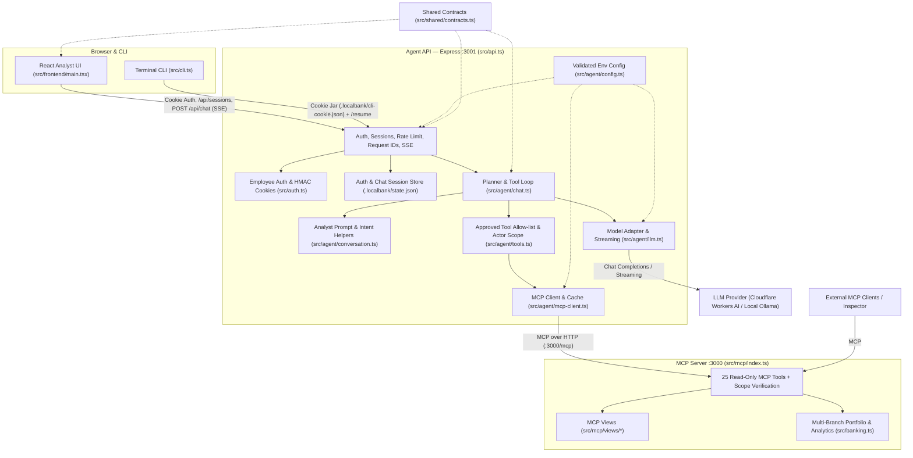
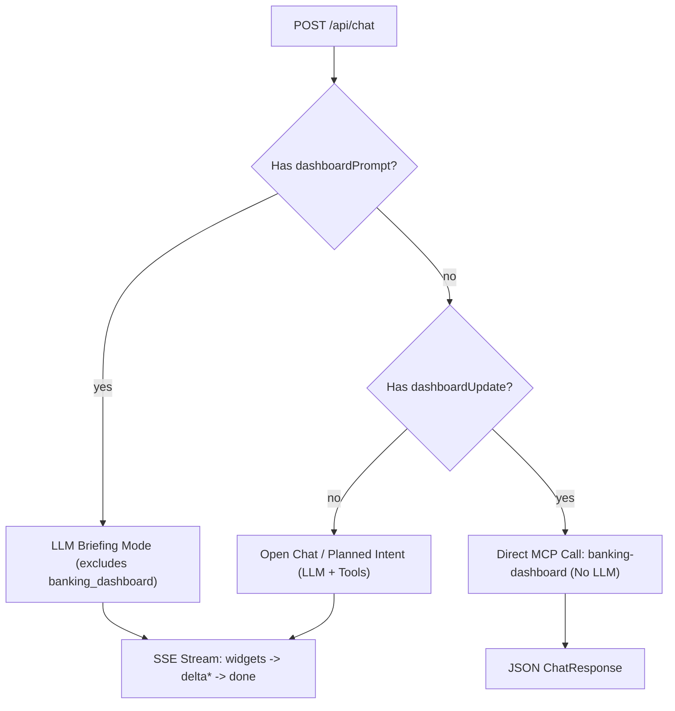
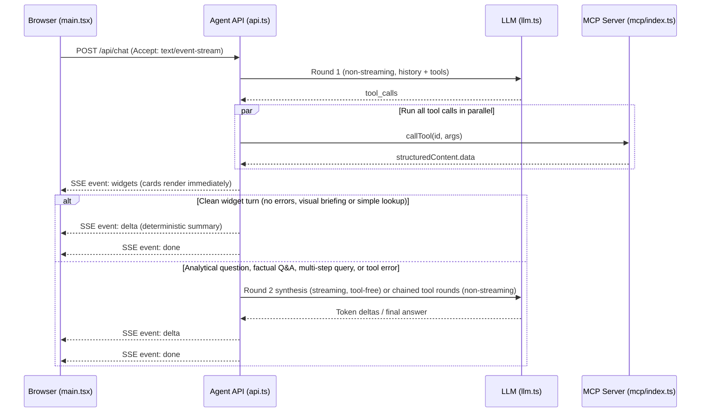

# LocalBank Analyst AI — Application Architecture

LocalBank Analyst AI is a read-only internal customer-analytics prototype for **bank employees** (relationship managers, credit analysts, and risk/operations teams) working on a synthetic multi-branch, multi-customer portfolio (6 branches, 18 customers: `CUST-1042` through `CUST-1390`, each with multiple accounts and transaction histories). It pairs a React + Vite workbench UI, a terminal CLI (`src/cli.ts`), an Express agent API with LLM tool orchestration, and an independent MCP server exposing 25 read-only analytics tools and MCP Views.

---

## 1. System Overview

Three Node.js processes run locally during development (`npm run dev`):

### Architectural Boundaries
- **Frontend (`src/frontend/main.tsx`, `src/frontend/components/*`):** Thin UI layer split into modular components (`LoginView`, `Sidebar`, `Widget`, `DashboardControls`), with email/password login (`credentials: 'include'`), sidebar session list (`/?session=<id>`), and a copyable `/resume <id>` shortcut for continuing chats in the CLI. In dev, [vite.config.ts](vite.config.ts) proxies `/api` to `http://127.0.0.1:3001`.
- **Terminal CLI (`src/cli.ts`, `src/cli/*`):** Modular interactive terminal client (`api-client`, `auth`, `sessions`, `format`, `render-portfolio`, `render-customer`) sharing `lb_session` cookies and `/resume` sessions with the web app.
- **Auth & Sessions (`src/auth.ts`, `src/store.ts`, `src/routes/*`):** Verifies employee email/password (`scryptSync` + `timingSafeEqual`), issues HMAC-signed `HttpOnly` `lb_session` cookies, stores auth and cross-surface chat sessions in `.localbank/state.json`, mounts `/api/auth/*` and `/api/sessions/*` routers, and signs short-lived `_auth` actor tokens verified on MCP calls.
- **Agent API (`src/api.ts`, `src/agent/*`):** Owns rate limiting, SSE streaming, LLM provider communication, tool allow-listing (`tools.ts`), widget summaries (`summarize.ts`), and MCP client lifecycle. Never imports `src/banking.ts` directly.
- **MCP Server (`src/mcp/index.ts`, `src/mcp/tools/*`, `src/mcp/views/*`) & Banking (`src/banking/*`):** Registers 25 tools grouped across `portfolio`, `customer`, and `simulators` backed by modular domain data/analytics/simulators (`src/banking/*` via `src/banking.ts` barrel), plus MCP Views (`mcp-use/react`). External MCP hosts (e.g. MCP Inspector at `:3000/mcp/inspector`) and the internal agent share the exact same tool contracts.
- **Shared Contracts (`src/shared/contracts.ts`):** Defines Zod request schemas (`loginRequestSchema`, `chatRequestSchema`, `createSessionSchema`, `dashboardUpdateSchema`, `dashboardPromptSchema`), `EmployeeProfile`, `ChatSessionSummary`, `WidgetKind`, `ChatResponse`, and `ChatStreamEvent`.

---

## 2. Startup & Health Probing

On startup, `src/api.ts` calls `prewarmServices()` immediately when the HTTP server begins listening:
1. **`probeModel()` (`src/agent/llm.ts`):** Verifies the configured Cloudflare Workers AI model (or local Ollama model) and caches healthy results (`ok && modelAvailable`) for `60_000 ms`, deduplicating concurrent probes via `modelProbePromise`.
2. **`getBankMcpConnection()` + `getModelTools()` (`src/agent/mcp-client.ts`, `src/agent/tools.ts`):** Establishes the `@mcp-use/client` session and populates `toolCache` (TTL controlled by `TOOL_CACHE_TTL_MS`). If the MCP server is still booting during `npm run dev`, a single deferred retry runs 2 seconds later via an `.unref()` timer.

`GET /api/health` reuses both caches so page refreshes return immediately without repeating live Cloudflare model searches or MCP `listTools()` calls unless a cache expired or a failure cleared it.

---

## 3. Request Flows (`POST /api/chat`)

`POST /api/chat` handles three payload shapes in priority order and supports both standard JSON and Server-Sent Events (`Accept: text/event-stream`):

### 3.1 Planning (`planRequest` in `src/agent/chat.ts`)
- **History Context:** `toModelMessages()` reads up to `HISTORY_WINDOW = 12` recent messages and appends a compact `[Displayed cards: ...]` summary of prior assistant `widgets` (`summarizeWidgetForHistory`) so follow-up questions can reference prior scenarios, inputs, and figures.
- **Dashboard Prompt (`dashboardPrompt`):** Blocks `banking_dashboard` so the model selects only the relevant individual tools, then wraps results into one `dashboard` widget.
- **Dashboard Intent (`detectDashboardIntent`):** Matches review/briefing phrases and restricts tools to `banking_dashboard` with the matching `scenario` and user-extracted `inputs`.
- **Savings Continuation (`isSavingsPlanContinuation`):** When following up on a savings request with months and a percentage, restricts tools to `savings_goal_planner` so the model extracts named parameters regardless of sentence order.
- **Open Chat:** Exposes all 25 allow-listed tools from `getModelTools()`.

### 3.2 Tool Execution & Conditional Round 2 (`runToolRounds`)

- **Non-Streaming Tool Rounds:** Tool-enabled turns call non-streaming `modelChat()` (`MAX_TOOL_ROUNDS = 3`) so Gemma 4 / Ollama extract structured `tool_calls` reliably without leaking raw `<|tool_call>` tokens into SSE text deltas (`stripControlTokens()` also guards non-streamed text). `sanitizeCloudflareMessages()` normalizes assistant `tool_calls[].function.arguments` strings to valid JSON.
- **Deduplication & Immediate Card Rendering:** `dedupeWidgets()` removes identical widgets and suppresses redundant standalone cards already bundled inside a `dashboard` briefing. Unless suppressed by `wantsVisualWidget()`, `api.ts` emits `{ type: 'widgets', widgets, widget }` over SSE immediately after MCP tools finish so cards render before summary text arrives.
- **Targeted Factual Question Suppression (`wantsVisualWidget`):** Narrow factual questions (e.g. `"Which branch has the highest loan book and how many open disputes does each branch have?"`) without visual display/simulation keywords still run MCP tools and Round 2 synthesis, but return `widgets: []` so full tables are not dumped into the UI or CLI.
- **Round 2 Optimization (`shouldSkipRound2`) & Tool-Free Synthesis (`synthesizeFromOutcomes`):** Clean visual lookup/briefing turns skip Round 2 and stream a deterministic `summarizeWidgetsForUser()` summary. Analytical questions without chained tool dependencies bypass intermediate tool re-serialization and stream a concise tool-free synthesis (`streamModelChat`) directly from retrieved tool outputs.

---

## 4. MCP Tools & UI Widgets

All 25 tools are registered in `src/mcp/index.ts` (`readOnlyHint: true`, `destructiveHint: false`, `openWorldHint: false`) and allow-listed in `toolTable` (`src/agent/tools.ts`):

| Category | MCP Tool ID | Model Tool Name | UI Widget Kind | Backing Logic (`src/banking.ts`) |
| --- | --- | --- | --- | --- |
| Portfolio KPIs | `portfolio-overview` | `portfolio_overview` | `portfolio` | `getPortfolioOverview()` |
| Bank Branches | `branch-overview` | `branch_overview` | `branches` | `getBranchOverview()` |
| Cohort Search | `customer-search` | `customer_search` | `customers` | `searchCustomers()` |
| Customer 360 | `customer-profile` | `customer_profile` | `customer360` | `getCustomerProfile()` |
| Segment Insights | `segment-insights` | `segment_insights` | `insights` | `getSegmentInsights()` |
| Risk & Compliance | `risk-and-compliance` | `risk_and_compliance` | `risk` | `getRiskAndCompliance()` |
| Product Adoption | `product-penetration` | `product_penetration` | `penetration` | `getProductPenetration()` |
| Regional AUM | `regional-breakdown` | `regional_breakdown` | `regions` | `getRegionalBreakdown()` |
| Liquidity & FDs | `liquidity-and-maturities` | `liquidity_and_maturities` | `liquidity` | `getLiquidityAndMaturities()` |
| Churn & Retention | `churn-and-retention` | `churn_and_retention` | `retention` | `getChurnAndRetention()` |
| Deposits | `account-balance` | `account_balance` | `balance` | `getBalance()` |
| Transactions | `recent-transactions` | `transaction_history` | `transactions` | `getTransactions()` |
| Spending | `spending-analytics` | `spending_analytics` | `spending` | `spendingInsights()` |
| Cards | `card-overview` | `card_status` | `cards` | `syntheticCustomers[].cards` |
| Fixed Deposits | `fixed-deposits` | `fixed_deposits` | `fds` | `getFixedDeposits()` |
| Loans | `loan-accounts` | `loan_accounts` | `loans` | `getLoans()` |
| Compliance | `kyc-status` | `kyc_status` | `kyc` | `syntheticCustomers[].kyc` |
| Disputes | `dispute-tracker` | `dispute_tracker` | `disputes` | `syntheticCustomers[].disputes` |
| FD Projection | `fixed-deposit-calculator` | `fixed_deposit_calculator` | `fd` | `calculateFd()` |
| EMI Projection | `loan-emi-calculator` | `loan_emi_calculator` | `emi` | `calculateEmi()` |
| Underwriting | `loan-eligibility-simulator` | `loan_eligibility_simulator` | `eligibility` | `loanEligibility()` |
| Cash Flow | `cash-flow-forecast` | `cash_flow_forecast` | `cashflow` | `projectCashFlow()` |
| Debt Payoff | `debt-payoff-comparison` | `debt_payoff_comparison` | `debtPlan` | `compareDebtPayoff()` |
| Savings Advisory | `savings-goal-planner` | `savings_goal_planner` | `savingsGoal` | `planSavingsGoal()` |
| Analyst Briefing | `banking-dashboard` | `banking_dashboard` | `dashboard` | `getBankingDashboard()` |

### Multi-Surface UI & CLI
- **Chat App (`src/frontend/main.tsx`):** Renders right-aligned analyst prompts, dots-only typing indicator while thinking, multi-widget briefing grids (5-card portfolio newsletter / 3-card customer, risk, and cross-sell briefings) above the assistant summary, editable assumption controls (`DashboardControls`), and customer/category filters (`CategoryControl`) that update via `dashboardUpdate` without invoking the LLM.
- **Terminal CLI (`src/cli.ts`):** Interactive readline REPL (`npm run cli`) with horizontal rule dividers (`─` / `·`), structured Unicode box-drawn tables and inline bars (`renderWidget`) rendered above the summary, `/health`, `/clear`, and `exit`/`exit()` commands. Multi-branch queries stay compact (`Branch Overview` table only), expanding per-branch customer sub-tables only when a single branch is queried.
- **MCP Views (`src/mcp/views/*/view.tsx`):** Standalone React views bundled by `mcp-use` (`useToolContext`, `useCallTool`, `ModelContext`) for external MCP hosts and the MCP Inspector.

---

## 5. Configuration (`src/agent/config.ts`)

`src/agent/config.ts` loads `.env` via `process.loadEnvFile()` (existing process env vars take precedence) and validates all values with Zod at startup:

| Variable | Default | Purpose |
| --- | --- | --- |
| `LLM_PROVIDER` | `cloudflare` | `cloudflare` or `ollama` |
| `CLOUDFLARE_ACCOUNT_ID` | unset | Cloudflare account ID for Workers AI |
| `CLOUDFLARE_API_TOKEN` | unset | Workers AI API token |
| `CLOUDFLARE_MODEL` | `@cf/google/gemma-4-26b-a4b-it` | Cloudflare Workers AI model ID |
| `OLLAMA_BASE_URL` | `http://127.0.0.1:11434` | Local Ollama HTTP endpoint |
| `OLLAMA_MODEL` | `gemma4:e4b` | Local Ollama model name |
| `OLLAMA_TIMEOUT_MS` | `120000` | Per-request LLM timeout (ms) |
| `API_PORT` | `3001` | Express API port (`PORT` overrides at runtime) |
| `API_URL` | `http://127.0.0.1:3001` | Agent API base URL used by `src/cli.ts` |
| `MCP_URL` | `http://127.0.0.1:3000/mcp` | MCP server endpoint |
| `TOOL_CACHE_TTL_MS` | `60000` | Cache TTL for MCP `listTools()` |
| `CORS_ORIGIN` | `http://127.0.0.1:5173` | Allowed browser origin (`credentials: true`) |
| `RATE_LIMIT_PER_MINUTE` | `60` | Fixed-window limit per client IP on `/api` |
| `AUTH_SECRET` | dev default | HMAC secret for `lb_session` cookies & `_auth` actor tokens |
| `SESSION_TTL_HOURS` | `24` | Cookie & auth session lifetime (hours) |

---

## 6. Security & Reliability Boundaries

### Implemented Protections
- **Read-Only by Construction:** Zero state-mutating banking tools exist; all MCP tools carry `readOnlyHint: true`.
- **Cookie Auth & Cross-Surface Sessions (`src/auth.ts`, `src/store.ts`, `src/api.ts`):** `/api/auth/login` verifies `scryptSync` password hashes and sets an HMAC-signed `HttpOnly` `lb_session` cookie (persisted in browser cookies and `.localbank/cli-cookie.json`). `/api/sessions/*` and `/api/chat` require a valid session cookie and isolate transcripts per `employeeId`.
- **Cookie-Derived Tool Authentication (`src/agent/tools.ts`, `src/mcp/index.ts`):** The verified cookie owner (`EmployeeProfile`) is signed into a short-lived `_auth` HMAC token (stripped from LLM schemas) and verified in `src/mcp/index.ts` before executing tools. Every authenticated employee can query the full synthetic portfolio.
- **Tool Allow-List & Schema Validation:** Unknown tool names are rejected in `executeAgentTool()`; all API payloads and tool arguments are validated with Zod.
- **Prompt Rules (`src/agent/conversation.ts`):** Forbids requesting OTPs/PINs/passwords/CVVs/full card numbers, refuses write actions, and instructs the model to treat merchant names and transaction descriptions as untrusted data.
- **API Guardrails (`src/api.ts`):** `256kb` JSON body cap, fixed-window per-IP rate limiting, CORS origin restriction (`credentials: true`), `X-Request-Id` correlation, and structured JSON request/error logging.
- **Safe Error Diagnostics (`src/agent/llm.ts`):** `describeFetchError()` exposes `error.cause` network/TLS error codes in server logs and error responses.

### Prototype Limitations (Before Production Use)
- **Persistence Backend:** Auth and chat sessions are stored locally in `.localbank/state.json` and synthetic employees are seeded in `src/auth.ts` — production should move to an external DB (e.g. Postgres + Redis) and enterprise OIDC/SSO.
- **Direct MCP Endpoint Protection:** If `:3000/mcp` is exposed beyond localhost, enforce an internal service auth check (e.g. require verified `_auth` / bearer secret on every MCP request instead of allowing anonymous local MCP Inspector access).
- **Rate Limiter & Headers:** In-memory `hits` map should move to a shared store (e.g. Redis) with entry eviction; Express should add security headers (`helmet` / CSP).
- **Automated Testing:** Needs unit tests for `src/banking.ts` math, contract tests for MCP tools, and an end-to-end eval suite for tool selection and safety refusals.
