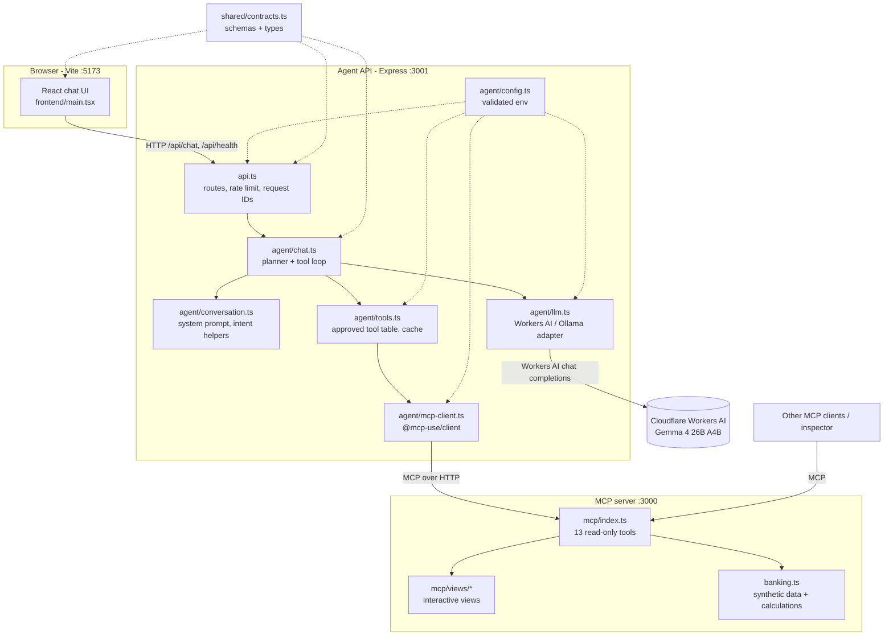
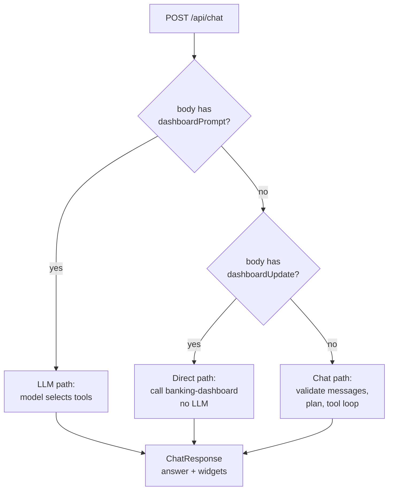
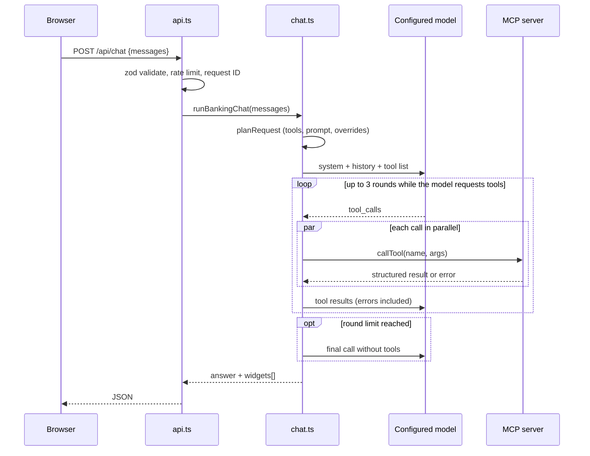

# LocalBank AI: Architecture

This document describes how LocalBank AI is built, how a request flows through it, and the design decisions behind it. For setup and usage, see [README.md](README.md).

All customer data is synthetic and every tool is read-only.

## 1. System overview

Three processes run locally. The agent and the MCP server are separate services.



| Component | Responsibility |
| --- | --- |
| React UI | Chat, widget rendering, dashboard controls. Holds no banking logic. |
| Agent API | HTTP boundary: validation, rate limiting, logging, health, error mapping. |
| Agent (`chat.ts`) | Decides how to serve a request, runs the model/tool loop, assembles widgets. |
| Model provider | Cloudflare Workers AI by default; optional Ollama local model. Chooses tools and writes the short answer. |
| MCP server | Single owner of the tool contracts (names, input schemas, outputs, views). |
| `banking.ts` | Synthetic records and pure calculations (EMI, FD, forecasts, payoff, savings). |

The agent never imports `banking.ts` functions. It reaches banking logic only through MCP tools, so external MCP clients and the agent see the same behavior.

## 2. Request flows

The API accepts three kinds of `POST /api/chat` body. They are checked in this order.



### 2.1 Chat path



### 2.2 Planning (`planRequest`)

`planRequest` picks exactly one plan per request:

| Plan | When | Tool set | Effect |
| --- | --- | --- | --- |
| Briefing prompt | `dashboardPrompt` present | All except `banking_dashboard` | Model chooses the relevant tools; the result is wrapped in one `dashboard` widget. |
| Dashboard review | Latest text matches a review intent (for example "credit readiness") | `banking_dashboard` only | The scenario is forced and the model's arguments are overridden. |
| Savings continuation | Follow-up supplying goal, savings, months and rate | `savings_goal_planner` only | Parsed values replace the model's arguments. |
| Open chat | Anything else | All tools | The model decides whether to call tools. |

Forced plans fail with a retryable error if the model produced no tool result.

### 2.3 Dashboard update paths

| Control | Path | LLM? |
| --- | --- | --- |
| Apply prompt | `dashboardPrompt` → planner → model selects tools → MCP | Yes |
| Update parameters | `dashboardUpdate` → `banking-dashboard` MCP tool | No |

## 3. Tool layer

Each tool in `agent/tools.ts` has one row in a table that links three names:

| Field | Example |
| --- | --- |
| MCP tool id | `account-balance` |
| Name shown to the model | `account_balance` |
| UI widget kind | `balance` |

- **Allow-list:** only tools in the table can be offered to or executed for the model. Unknown tool names are rejected.
- **Discovery cache:** the MCP tool list is cached (`TOOL_CACHE_TTL_MS`) and cleared when a call fails.
- **Reconnect:** a failed MCP call resets the connection, so the next request reconnects, for example after an MCP restart.
- **Validation:** tool arguments must be a JSON object. MCP validates each tool's input schema (ranges and types) server side.
- **Failures are data:** an invalid or failed call is returned to the model as a tool error so it can correct itself or explain, instead of aborting the request.

### MCP tools

| Group | Tools |
| --- | --- |
| Accounts and activity | `account-balance`, `recent-transactions`, `spending-analytics` |
| Cards and compliance | `card-overview`, `kyc-status`, `dispute-tracker` |
| Calculators | `fixed-deposit-calculator`, `loan-emi-calculator`, `loan-eligibility-simulator` |
| Planning | `cash-flow-forecast`, `debt-payoff-comparison`, `savings-goal-planner` |
| Composite | `banking-dashboard` |

Every tool is annotated `readOnlyHint: true`, `destructiveHint: false`, `openWorldHint: false`, and returns `structuredContent: { data }` with a matching interactive view.

## 4. Contracts

`shared/contracts.ts` is the single definition of the browser-to-agent boundary. The frontend imports types only.

```ts
ChatRequest   = { messages: { role: 'user' | 'assistant'; content: string }[] }   // max 50, 8000 chars each
ChatResponse  = { answer; widget; widgets[]; model; toolInvoked }
Widget        = { widget: WidgetKind } & Record<string, unknown>
```

`widgets[]` holds every tool result from a turn. `widget` is the last one, kept for older clients. Unknown fields in incoming messages are stripped by validation.

## 5. Configuration

`agent/config.ts` loads `.env` (existing environment variables win), validates with zod, and exits at startup on invalid values.

| Variable | Default |
| --- | --- |
| `LLM_PROVIDER` | `cloudflare` |
| `CLOUDFLARE_ACCOUNT_ID` | unset |
| `CLOUDFLARE_API_TOKEN` | unset |
| `CLOUDFLARE_MODEL` | `@cf/google/gemma-4-26b-a4b-it` |
| `OLLAMA_BASE_URL` | `http://127.0.0.1:11434` |
| `OLLAMA_MODEL` | `gemma4:e4b` |
| `OLLAMA_TIMEOUT_MS` | `120000` |
| `API_PORT` | `3001` |
| `MCP_URL` | `http://127.0.0.1:3000/mcp` |
| `TOOL_CACHE_TTL_MS` | `60000` |
| `CORS_ORIGIN` | `http://127.0.0.1:5173` |
| `RATE_LIMIT_PER_MINUTE` | `60` |

## 6. Operations

- **Health:** `GET /api/health` probes the configured model provider and MCP (reachable, tool count). `ok` is true only when both are healthy.
- **Observability:** every response carries `X-Request-Id`, and each request writes one JSON log line (`requestId`, method, path, status, ms). Failures log the same ID.
- **Limits:** `/api` is rate limited per client address; request bodies are capped at 256 KB; model calls time out.
- **Network:** the API binds to `127.0.0.1` and allows only the configured browser origin.
- **Errors:** malformed JSON returns 400, oversized bodies 413, model or tool failures 503 (briefing prompt and chat) or 400 (direct dashboard update).

## 7. Safety model

- The system prompt forbids claiming any transfer, payment, card change, approval or complaint, and forbids requesting OTPs, PINs, passwords, CVVs or card numbers.
- Tools are read-only by construction and by annotation.
- Transaction descriptions are treated as untrusted text in the prompt.
- Tool names are allow-listed and arguments are schema-validated by MCP.
- Model output alone never authorizes an action; there are no write tools.

## 8. Known limitations and next steps

| Area | Current state | Suggested direction |
| --- | --- | --- |
| Intent routing | Regular expressions in `conversation.ts` force some tools | A small structured router step, with an evaluation set |
| Latency | Non-streaming Ollama calls | Stream tokens and tool-progress events to the UI |
| Identity | One synthetic customer, no `customerId` | Thread a customer ID through agent and MCP; add a repository interface behind `banking.ts` |
| Structure | Calculations and fixtures share `banking.ts` | Split into pure `calc/` and `data/` modules with unit tests |
| Rate limiting | In-memory, per process | Shared store if the API is ever scaled out |
| Testing | No automated tests | Calculation unit tests, MCP contract tests, an end-to-end test with Ollama stubbed |
| Production use | Demo only | Authentication, authorization, audited data sources, privacy controls, human escalation and compliance review |
