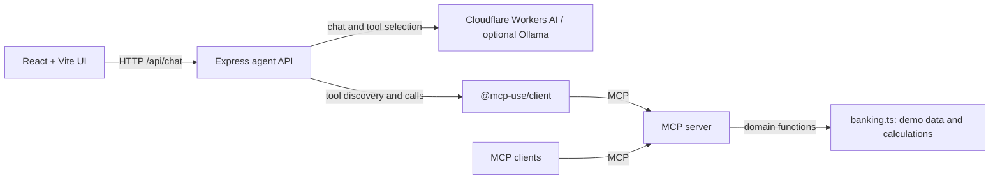

# LocalBank AI

LocalBank AI is a banking support demo. It combines a React chat interface, an AI-powered agent, and an MCP server exposing synthetic banking tools. The default model provider is Cloudflare Workers AI using Gemma 4 26B A4B Instruct, a hosted model with 4B active parameters. Ollama remains available as an optional local provider. The demo is read-only and does not connect to real accounts, payment networks, or bank services.

## What it includes

- Account balance and account summaries
- Recent transaction history
- Debit and credit card status
- Spending category summaries
- Fixed deposit and loan EMI estimates
- Indicative loan affordability simulations
- Savings goal planning, cash-flow forecasts, and debt payoff comparisons
- KYC status and dispute tracking
- Prompt-driven money briefings that show only the relevant widgets

All customer records and financial values are synthetic examples.

This guide is stored in `src/README.md`. The project root is the parent directory of `src` and contains `package.json`; run the npm commands from the project root.

## Architecture



The agent and MCP server are separate services. The agent uses `@mcp-use/client` to discover MCP tools and execute the tools selected by the model. Both services use the shared domain functions in `src/banking.ts`; the agent does not call those functions directly.

### Dashboard prompt behavior

- **Apply prompt** sends the additional prompt and current assumptions to the configured model. The model interprets the request, selects one or more relevant MCP tools, and the agent calls them through `@mcp-use/client`. The results become the briefing's widgets.
- **Update parameters** sends the changed numeric assumptions directly to the MCP `banking-dashboard` tool. It recalculates the dashboard without another LLM request.

## Requirements

- Node.js 20.12 or newer
- npm
- Cloudflare account with Workers AI enabled and an API token with Workers AI Read or Write permission (default provider)
- Or [Ollama](https://ollama.com/download) for local inference

The default model is `@cf/google/gemma-4-26b-a4b-it`, Cloudflare's hosted Gemma 4 26B A4B model (4B active parameters). It is similar in active parameter count to local `gemma4:e4b`, but is not the same quantized model build.

## Run locally

### 1. Install dependencies

From the project root:

```bash
npm install
```

### 2. Configure the model provider

For Cloudflare Workers AI (the default), put these values in `.env` at the project root:

```dotenv
LLM_PROVIDER=cloudflare
CLOUDFLARE_ACCOUNT_ID=your-cloudflare-account-id
CLOUDFLARE_API_TOKEN=your-workers-ai-api-token
CLOUDFLARE_MODEL=@cf/google/gemma-4-26b-a4b-it
```

Keep the API token private. Workers AI provides a daily free Neurons allocation; usage beyond free limits may require a paid plan. See [Cloudflare Workers AI pricing](https://developers.cloudflare.com/workers-ai/platform/pricing/).

To use Ollama instead, set `LLM_PROVIDER=ollama`, install Ollama, and pull a local model:

```bash
ollama serve
ollama pull gemma4:e4b
```

### 3. Start LocalBank AI

From the project root, run:

```bash
npm run dev
```

This starts the Vite frontend, Express agent API, and MCP server as separate processes.

### 4. Open the app

- Chat UI: <http://127.0.0.1:5173/>
- Agent health: <http://127.0.0.1:3001/api/health>
- MCP endpoint: <http://localhost:3000/mcp>
- MCP inspector: <http://localhost:3000/mcp/inspector>

## Configuration

Copy `.env.example` to `.env` in the project root. The agent API loads it at startup; variables already set in the process environment take precedence. Values are validated with zod, and the API exits with a clear message if one is invalid.

| Variable | Default | Purpose |
| --- | --- | --- |
| `LLM_PROVIDER` | `cloudflare` | `cloudflare` or `ollama` |
| `CLOUDFLARE_ACCOUNT_ID` | unset | Cloudflare account ID for Workers AI |
| `CLOUDFLARE_API_TOKEN` | unset | Secret API token authorized to run Workers AI models |
| `CLOUDFLARE_MODEL` | `@cf/google/gemma-4-26b-a4b-it` | Workers AI model ID |
| `OLLAMA_BASE_URL` | `http://127.0.0.1:11434` | Ollama HTTP API address |
| `OLLAMA_MODEL` | `gemma4:e4b` | Model used by the agent |
| `OLLAMA_TIMEOUT_MS` | `120000` | Per-request timeout for model calls |
| `API_PORT` | `3001` | Express agent API port |
| `MCP_URL` | `http://127.0.0.1:3000/mcp` | MCP endpoint used by the agent |
| `TOOL_CACHE_TTL_MS` | `60000` | How long the MCP tool list is cached |
| `CORS_ORIGIN` | `http://127.0.0.1:5173` | Allowed browser origin |
| `RATE_LIMIT_PER_MINUTE` | `60` | Requests per client per minute on `/api` |

### Hosting notes

- The API uses Render's `PORT` when present and listens on `0.0.0.0`, as required for a Render web service.
- Set `VITE_API_BASE_URL` at frontend build time to the deployed API origin (for example, `https://your-service.onrender.com`). Leave it unset for local development, where Vite proxies `/api` to the local API.
- Configure the deployed API's `CORS_ORIGIN` to the exact Cloudflare Pages origin.
- The API and MCP server can be run together in a single Render demo service using the production `mcp-use build` and `mcp-use start` commands.

### Agent behavior

- **Typed contracts:** `src/shared/contracts.ts` defines the request schemas, widget kinds, and `ChatResponse`. Responses carry `widgets[]` (all tool results) and `widget` (the last one, for older clients).
- **Tool calls:** calls in one model turn run in parallel. A failed or invalid call is reported back to the model as a tool error instead of failing the request. After 3 tool rounds the agent asks for a plain answer from the results so far.
- **Health:** `/api/health` checks the configured model provider and MCP server, and reports each under `services`.
- **Operations:** each request gets an `X-Request-Id` and one JSON log line; `/api` is rate limited; the MCP connection is re-established automatically after a failure.

## Useful commands

| Command | Description |
| --- | --- |
| `npm run dev` | Start frontend, agent API, and MCP server |
| `npm run dev:frontend` | Start only the Vite frontend |
| `npm run dev:api` | Start only the Express agent API |
| `npm run dev:mcp` | Start only the MCP server and inspector |
| `npm run build` | Build the frontend and run the TypeScript check |
| `npm run preview` | Preview the built frontend |

For isolated development, start the API and MCP server separately; the chat agent needs the MCP endpoint to be available when it discovers or calls tools.

## Project layout

```text
src/
  api.ts                         Express routes, health, rate limit, request logging
  banking.ts                     Synthetic records and banking calculations
  shared/
    contracts.ts                 Request/response schemas and widget types
  agent/
    config.ts                    Validated environment configuration
    llm.ts                        Cloudflare Workers AI and Ollama model clients
    chat.ts                      Request planning and tool-call loop
    conversation.ts              System prompt and request intent helpers
    mcp-client.ts                @mcp-use/client connection, reconnect, probe
    tools.ts                     Tool table, cached discovery, MCP tool execution
  frontend/
    main.tsx                     React chat UI and widgets
    style.css                    UI styling
  mcp/
    index.ts                     MCP server tool definitions
    views/                       Interactive MCP Views
```

## Example prompts

- “Create a money briefing with my account balances, top spending categories, and a six-month cash-flow outlook.”
- “Show only my account balances and recent transactions.”
- “Create a credit readiness briefing with my cards and a hypothetical loan. Include EMI and affordability.”
- “Plan a savings goal and include a fixed deposit comparison.”
- “Review my cards, recent transactions, open disputes, and KYC status.”

## Safety and limitations

This is an educational prototype with synthetic data. It is not a banking product and does not perform transfers, payments, card changes, account changes, complaints, loan applications, or approvals. Do not enter real customer information, account numbers, card details, passwords, PINs, CVVs, or OTPs.

A real deployment would require authenticated users, authorization, audited data sources, privacy controls, secure secrets handling, monitoring, rate limits, human escalation, model/tool evaluation, and legal and compliance review. Never use an LLM response alone to authorize a financial action.
